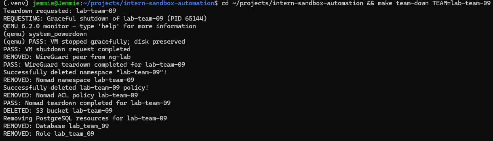

# Intern Sandbox Automation

**Automated Provisioning and Teardown of Isolated Development Environments**

## Overview

Intern Sandbox Automation provides a reproducible, command-driven solution for managing team-specific development environments.

The project automates virtual machine provisioning, VPN access, workload isolation, database management, and object storage through a unified Makefile interface.

**Status:** Completed local proof of concept.

## Technology Stack

| Technology | Purpose |
|---|---|
| Terraform & Ansible | Infrastructure and configuration management |
| GNU Make & Bash | Lifecycle automation |
| QEMU/KVM & Cloud-init | VM provisioning and initialization |
| WireGuard | Secure VPN peer management |
| HashiCorp Nomad | Namespace and ACL management |
| PostgreSQL | Team-specific databases and roles |
| LocalStack (S3) | Isolated object storage |
| Ubuntu WSL2 | Local development environment |

## Automated Lifecycle

### Provision a Sandbox

```bash
make team-up TEAM=lab-team-09
```

Creates or reuses the team's VM, WireGuard peer, Nomad namespace and ACL policy, PostgreSQL database and role, and S3 bucket.

### Tear Down a Sandbox

```bash
make team-down TEAM=lab-team-09
```

Performs team-scoped cleanup, including graceful VM shutdown, WireGuard peer removal, Nomad resource deletion, S3 bucket deletion, and PostgreSQL database, role, and credential cleanup.

VM disks are preserved to prevent accidental data loss.

## Security and Reliability

- Validates team identifiers before infrastructure operations.
- Uses scoped access controls and restricted database privileges.
- Detects existing resources to support repeatable provisioning.
- Protects credentials, SSH keys, and generated files from version control.
- Applies ownership checks and safeguards to destructive operations.
- Keeps testing isolated from production infrastructure.

## Validation Results

| Component | Verified Operation |
|---|---|
| Virtual Machine | Provisioning, SSH access, graceful shutdown |
| WireGuard | Peer creation and removal |
| Nomad | Namespace and ACL creation and deletion |
| PostgreSQL | Database, role, and credential lifecycle |
| S3 Storage | Bucket creation and deletion |
| Automation | Resource reuse and lifecycle execution |

The local lab demonstrated team-specific provisioning and teardown, with component-level cleanup verified.

## Evidence



*Figure 1: Sandbox teardown validation showing successful team-specific resource cleanup.*

## Documentation

- [System Architecture](docs/architecture.md)
- [Manual Provisioning Runbook](docs/manual-provisioning.md)
- [Lifecycle Validation Report](docs/lifecycle-validation.md)


## Project Outcome

Implemented a reusable infrastructure automation workflow that reduces manual provisioning effort, standardizes team sandbox management, and supports controlled resource cleanup.

