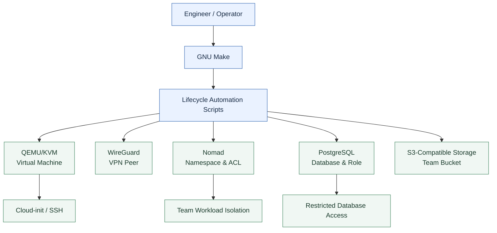

# System Architecture

## Overview

Intern Sandbox Automation provides a centralized, repeatable workflow for provisioning and decommissioning isolated team development environments.

GNU Make coordinates component-specific Bash scripts, while QEMU/KVM, WireGuard, Nomad, PostgreSQL, and S3-compatible storage provide the underlying infrastructure.

## Architecture Diagram



## Infrastructure Components

| Component | Responsibility |
|---|---|
| GNU Make | Provides the unified lifecycle command interface |
| Bash | Executes resource-specific provisioning and teardown operations |
| QEMU/KVM | Manages team virtual machines |
| Cloud-init | Initializes guest configuration and hostnames |
| WireGuard | Manages secure team VPN peers |
| HashiCorp Nomad | Provides namespaces and scoped ACL policies |
| PostgreSQL | Creates team databases and restricted roles |
| S3-compatible storage | Provides team-specific object storage |
| Terraform & Ansible | Support infrastructure configuration and automation |

## Provisioning Workflow

```bash
make team-up TEAM=lab-team-09
```

1. Validate the team identifier.
2. Create or reuse the team VM.
3. Configure and register the WireGuard peer.
4. Create the Nomad namespace and ACL policy.
5. Provision the PostgreSQL database and role.
6. Create the S3-compatible bucket.
7. Validate the resulting resources.

## Teardown Workflow

```bash
make team-down TEAM=lab-team-09
```

1. Validate team identity and resource ownership.
2. Gracefully shut down the VM.
3. Remove the WireGuard peer.
4. Delete team-specific Nomad resources.
5. Remove the S3 bucket.
6. Delete the PostgreSQL database, role, and local credentials.

VM disks are retained to prevent unintended data loss.

## Security Design

- Team-scoped resource naming and ownership validation.
- Restricted PostgreSQL privileges and Nomad ACL policies.
- SSH public-key authentication and WireGuard VPN credentials.
- Exclusion of secrets, keys, and runtime files from version control.
- Explicit confirmation and safety checks for destructive operations.
- Isolation of testing from production infrastructure.

## Validation and Deployment Scope

The architecture was exercised in an isolated Ubuntu WSL2 lab, covering provisioning, resource reuse, component cleanup, and graceful VM shutdown.